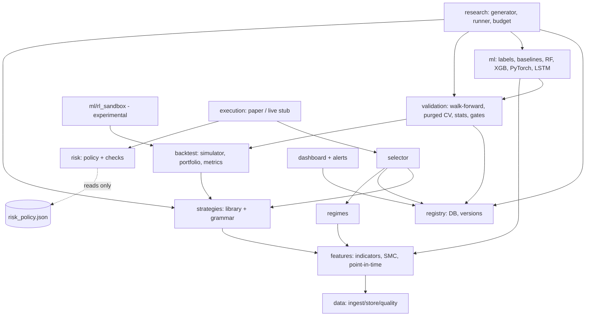
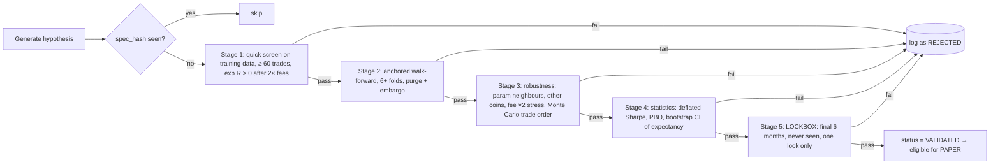
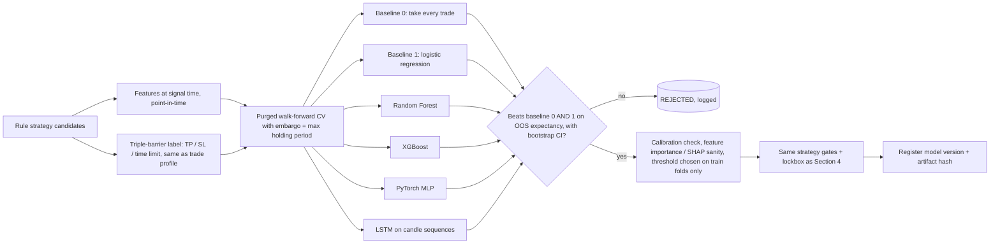

# Self-Learning Quant Research Platform: Upgrade Design (DRAFT, awaiting approval)

Status: **proposal only. Nothing in this document is implemented yet.**
Scope: research, validation, strategy selection and paper trading. Real-money execution stays out of scope
until a separate, explicit approval.

---

## 0. What exists today (inspection)

| File | Lines | What it does | Keep / change |
|---|---|---|---|
| `crypto-signals/signals.py` | 460 | v1: EMA/RSI/volume signals, simple backtest, HTML, Telegram/Issue alerts | Retire after v3 ships (keep in git history) |
| `engine/smc.py` | 151 | Binance public data fetch; ATR, volume, HTF trend; swings, BOS/MSS, sweeps, OB, FVG (no look-ahead) | **Reuse** → split into `data/` + `features/` |
| `engine/backtest.py` | 368 | 3 SMC setups, order fills, managed exits, INR spot portfolio, IS/OOS metrics, regime table | **Reuse** simulator core → `backtest/`; setups → `strategies/` |
| `engine/run.py` | 295 | CLI, paper forward-replay, HTML report, GitHub Issue alerts | Split → `paper/`, `dashboard/`, `alerts/` |
| `engine/config.json` | | universe, risk, profiles, paper settings | Split: **immutable `risk_policy.json`** + research config |
| `.github/workflows/crypto-signals.yml` | | runs engine every 4h | Keep for paper/selector; add weekly research + PR test jobs |

Known gaps: no tests, no persistence (every run recomputes), no walk-forward, no multiple-testing control,
no versioning, only 5 coins × ~2.7 years of 4h data, only a single train/test split.

**Starting point from the last backtest:** none of 32 SMC strategy/profile combinations had a validated edge.
The new platform must be allowed to reach the same conclusion. **HOLD is a valid, expected output.**

---

## 1. Updated architecture

Four layers. Information flows downward. Nothing in the research layer can write to the risk policy or to execution.

```
┌────────────────────────────── RESEARCH (offline, heavy, weekly) ─────────────────────────────┐
│  Hypothesis Generator ─► Experiment Runner ─► Validation Gates ─► Strategy/Model Registry   │
│        ▲  (grammar + search)      │ (backtest, walk-forward)   │ (stats, overfit checks)     │
│        └──── Experiment Log ◄─────┴────────────────────────────┘                             │
│  ML Lab: labels → purged walk-forward CV → baselines vs RF/XGB/PyTorch/LSTM → registry       │
│  RL Sandbox (experimental, never auto-eligible)                                              │
└──────────────────────────────────────────────────────────────────────────────────────────────┘
                     │ read-only: strategies with status ≥ PAPER
┌──────────────────── DECISION (every 4h, light) ──────────────────────────────────────────────┐
│  Data Ingest ─► Feature Store (point-in-time) ─► Regime Detector ─► Strategy Selector        │
│                                                         └─► signal or HOLD                   │
└──────────────────────────────────────────────────────────────────────────────────────────────┘
                     │
┌──────────────────── RISK GATE (immutable policy, human-owned) ───────────────────────────────┐
│  Pre-trade checks: risk % cap, spot-only, cash, open positions, daily/weekly loss, kill-switch│
└──────────────────────────────────────────────────────────────────────────────────────────────┘
                     │
┌──────────────────── EXECUTION ───────────────────────────────────────────────────────────────┐
│  Paper broker (simulated fills, fees, slippage)   │   Live broker: NOT BUILT (stub that      │
│                                                   │   raises; needs separate approval)       │
└──────────────────────────────────────────────────────────────────────────────────────────────┘
                     │
        Dashboard + Alerts (static HTML + GitHub Issues), audit log
```

### Proposed package layout

```
crypto-signals/quant/
  data/         ingest.py (Binance public klines, retries), store.py (SQLite/Parquet), quality.py (gaps, dupes)
  features/     indicators.py, smc.py (moved), pit.py (point-in-time alignment, HTF by close-time)
  regimes/      rules.py (trend × volatility, hysteresis), hmm.py (optional, later)
  strategies/   base.py (Strategy interface + param space), library/ (8 families), grammar.py (generated rules)
  backtest/     simulator.py (fills, exits, fees, slippage), portfolio.py (INR spot sizing), metrics.py
  validation/   walkforward.py, purged_cv.py, stats.py (DSR, bootstrap, PBO), gates.py
  research/     generator.py (random + genetic search), runner.py, budget.py
  ml/           labels.py (triple-barrier / meta-labels), baselines.py, trees.py (RF, XGB),
                torch_models.py (MLP, LSTM), rl_sandbox/ (experimental)
  registry/     db.py (schema + migrations), versions.py (hashing, promote/rollback)
  selector/     selector.py (regime → validated strategy or HOLD)
  risk/         policy.py (load + hash-verify risk_policy.json), checks.py
  execution/    paper.py, live.py (disabled stub)
  dashboard/    build.py (HTML from DB)
  alerts/       github_issues.py, telegram.py
  cli.py        research | validate | select | paper | dashboard | promote | rollback
  risk_policy.json      ← changed only by a human commit (CODEOWNERS + hash check)
tests/          unit, leakage, simulator, null-hypothesis, regression
```

---

## 2. Module dependency diagram

Arrows mean "imports / depends on". `risk` and `execution` never import `research` or `ml`.



Enforced by a test that parses imports: `risk/` and `execution/` must not import `research`, `ml` or `validation`,
and nothing except `risk/policy.py` may open `risk_policy.json`.

---

## 3. Database design (SQLite, one file: `quant.db`)

SQLite is enough at this scale (a few million candles) and is easy to version and back up. Candles can move to
Parquet later if they grow. All tables are append-mostly; status changes are new rows in `promotions`, not edits.

```mermaid
erDiagram
    candles { text symbol PK; text tf PK; int open_time PK; real o; real h; real l; real c; real v; text source; int ingested_at }
    datasets { int id PK; text symbols; text tf; int start; int end; text sha256 }
    feature_specs { int id PK; text name; int version; json params; text code_hash }
    strategies { int id PK; text family; text name; json params; text spec_hash UK; text origin; int parent_id FK; text status; int created_at }
    experiments { int id PK; int strategy_id FK; int model_id FK; int dataset_id FK; text kind; json config; text code_commit; int seed; int trial_no; text status; int started; int finished }
    metrics { int experiment_id FK; text scope; int trades; real win_rate; real avg_win; real avg_loss; real pf; real exp_r; real net; real fees; real max_dd; int max_loss_streak; real sharpe; real dsr; real pbo }
    trades { int id PK; int experiment_id FK; int paper_run_id FK; text symbol; text side; int entry_time; real entry; int exit_time; real exit; real size_inr; real fees; real pnl; real r; text regime; text exit_reason }
    models { int id PK; text type; text version; int strategy_id FK; int dataset_id FK; int feature_spec_id FK; json hyperparams; text artifact_path; text artifact_sha256; text train_range; text status; int created_at }
    regimes { text symbol PK; text tf PK; int time PK; text trend; text vol; text detector_version }
    selector_decisions { int id PK; int time; text symbol; text regime; int strategy_id FK; text action; text reason; json inputs }
    promotions { int id PK; int strategy_id FK; int model_id FK; text from_status; text to_status; json gate_results; text approved_by; int at }
    paper_runs { int id PK; int started; json config; text risk_policy_sha256; text status }
    risk_policy_versions { text sha256 PK; json policy; text approved_by; text git_commit; int at }
    audit_log { int id PK; int at; text actor; text action; json detail }

    strategies ||--o{ experiments : tested_in
    experiments ||--o{ metrics : produces
    experiments ||--o{ trades : records
    datasets ||--o{ experiments : uses
    strategies ||--o{ models : filtered_by
    models ||--o{ experiments : evaluated_in
    strategies ||--o{ promotions : lifecycle
    strategies ||--o{ selector_decisions : chosen
    paper_runs ||--o{ trades : records
```

Key rules:
- **Failed experiments are stored too.** `trial_no` counts every test per family; it feeds the multiple-testing correction.
- `spec_hash` = hash of (family, params, exit profile, universe, timeframe). Duplicate hypotheses are never re-tested.
- Model artifacts are files on disk (`models/<type>/<version>/model.bin`) plus their SHA-256 in `models`.
  **Rollback** = set a previous version's status back to `ACTIVE` via a new `promotions` row. Nothing is deleted.
- `metrics.scope`: `is`, `oos`, `wf_fold_<k>`, `lockbox`, `regime:<Bull/HighVol>`, `paper`.
- Every paper run stores the SHA-256 of the risk policy it ran under.

---

## 4. Strategy research workflow

### 4.1 Hypothesis space
1. **Library strategies** (hand-written, parameterised):

| Family | Core idea | Spot-only note |
|---|---|---|
| Trend following | EMA/Donchian trend + pullback entries, ATR trail | ok |
| Breakout | N-bar high / volatility contraction → expansion with volume | ok |
| Momentum | time-series momentum (ROC), cross-sectional ranking across coins (buy the top) | ok, long-only |
| Mean reversion | Bollinger/RSI extremes in a range regime, exit at mean | ok |
| Liquidity sweep | sweep + reclaim (from v2) | ok |
| SMC | BOS/MSS + OB/FVG retest (from v2) | ok |
| Volatility | squeeze breakout, ATR-regime switching, vol-targeted sizing | ok |
| Statistical arbitrage | pairs / cointegration (e.g. ETH/BTC spread) | **Classic stat-arb needs shorting, which spot can't do.** Only a long-only "buy the cheap leg, hold cash otherwise" variant is possible, and it's weaker. Included, but flagged. |

2. **Generated strategies** (`grammar.py`): entry = AND of 1–3 primitives drawn from
   {trend filter, momentum, oscillator extreme, breakout, volume condition, volatility state, SMC event, regime constraint},
   each with a small discrete parameter grid. Exit = one of the R:R / managed profiles. Complexity is capped
   (max 3 conditions, max ~6 free parameters), because more freedom means more overfitting.

### 4.2 Pipeline (each stage is cheaper than the next; most hypotheses die early)



### 4.3 Data splits (leakage prevention)

```
|<────────── research data (walk-forward folds) ──────────>|<─ embargo ─>|<── LOCKBOX (6 months) ──>|<─ paper (live forward) ─>
 fold1: train ▓▓▓▓ test ░░
 fold2: train ▓▓▓▓▓▓ test ░░
 fold3: train ▓▓▓▓▓▓▓▓ test ░░   … (anchored, expanding)
```
- The lockbox is opened only by `validate --lockbox`, which logs every look. A second look at the same family's lockbox is flagged.
- **Every trial counts.** The deflated Sharpe ratio uses the number of trials actually run, so the more the generator searches, the higher the bar.

### 4.4 Promotion gates (default thresholds, all configurable by you, not by the AI)
| Gate | Threshold |
|---|---|
| Trades (walk-forward OOS, all coins) | ≥ 100 |
| Walk-forward folds profitable | ≥ 60% |
| OOS profit factor (after 0.1% fee + 0.05% slippage per side) | ≥ 1.2, and still > 1.0 with fees doubled |
| Expectancy | bootstrap 95% lower bound > 0 R |
| Deflated Sharpe probability | ≥ 0.95 |
| Probability of backtest overfitting (PBO, CSCV) | ≤ 0.3 |
| Parameter stability | ≥ 70% of neighbouring parameter sets also positive |
| Max drawdown (at 1% risk) | ≤ 20% |
| Not one-coin dependent | positive on ≥ 3 of 5 coins |
| Lockbox | exp R > 0 and PF > 1.0 |
| Paper trading | ≥ 90 days **and** ≥ 30 trades; results inside the backtest's 90% Monte Carlo band |

Lifecycle: `CANDIDATE → REJECTED | VALIDATED → PAPER → PAPER_PASSED → APPROVED_LIVE (human only) → RETIRED`.
Automatic demotion: a PAPER strategy whose live drawdown exceeds the 95th-percentile backtest drawdown is moved to `RETIRED`.

---

## 5. Machine-learning workflow

**Main design choice: meta-labelling, not price prediction.** Models don't predict "will BTC go up". They predict
**"will this specific rule-based setup reach its target before its stop?"** The model can only filter trades
(take or skip). It can never invent trades. This is much easier to validate and harder to overfit.



Rules:
- **Simplicity preference:** a complex model is accepted only if it beats the next simpler model by a clear margin
  (e.g. +0.05 R expectancy with a non-overlapping bootstrap CI). Otherwise the simpler one wins.
- **Data reality:** ~6,000 4h candles per coin give only a few hundred setups. That is thin for deep learning.
  The LSTM is included as an experiment; I expect it not to pass, and that would be recorded as a result.
  1h data (about 4× more samples) and more coins will be tested to give models a fair chance.
- Scalers and feature selection are fit inside each training fold only. Random seeds are fixed and logged.
- **Retraining:** scheduled (e.g. monthly) on an expanding window. A new version must beat the current version on the
  newest OOS fold, otherwise it is stored but not activated.
- **Reinforcement learning (sandbox):** a Gym-style env built on the same simulator, fees and risk policy. An agent
  (e.g. PPO) chooses only {hold, enter, exit} for one coin. It is never selectable by the live selector unless a human
  promotes it after it passes the same gates. Expect it to fail; it's there to learn from.

Libraries (pinned versions): `scikit-learn`, `xgboost`, `torch` (CPU), optional `gymnasium` + `stable-baselines3`.

---

## 6. Regime detection and strategy selector

**Regime (per coin, computed on the closed daily candle, with hysteresis so it doesn't flip every day):**
- Trend: Bull / Bear / Sideways, from EMA50/200 slope and position plus ADX (Sideways when ADX < 20 or EMAs are flat).
- Volatility: High / Normal / Low, from ATR% percentile over the last 365 days (>66th / <33rd).
- That gives up to 9 combined states (e.g. `Bull/HighVol`). A rule-based detector comes first; an HMM is an optional
  later experiment that must beat the rules on selector OOS performance.

**Selector logic (every 4h):**
```
for each coin:
    regime = detect(coin)               # point-in-time
    eligible = strategies with status in {PAPER, PAPER_PASSED, APPROVED_LIVE}
               and ≥ 30 OOS trades in this regime
               and regime-conditional bootstrap lower bound of expectancy > 0
    if none: action = HOLD (reason logged)
    else: pick the highest lower-bound strategy; if it has a signal now → order to risk gate
```
Every decision, including HOLD, is written to `selector_decisions` with the inputs behind it, so it can be audited and
replayed. The selector itself is walk-forward tested as a strategy: "selector vs best single strategy vs buy-and-hold BTC".

---

## 7. Risk management design

### 7.1 Immutable risk policy (`risk_policy.json`, human-owned)
```json
{
  "mode": "paper",
  "spot_only": true, "leverage": false, "borrowing": false,
  "capital_inr": 10000,
  "risk_per_trade_pct": 0.5, "risk_per_trade_hard_max_pct": 1.0,
  "max_open_positions": 2, "max_exposure_per_coin_pct": 50,
  "daily_loss_limit_pct": 2, "weekly_loss_limit_pct": 4,
  "kill_switch_drawdown_pct": 15,
  "min_order_inr": 100,
  "allowed_symbols": ["BTCUSDT","ETHUSDT","SOLUSDT","BNBUSDT","XRPUSDT"],
  "fees_pct": 0.1, "slippage_pct": 0.05
}
```

### 7.2 Controls that keep the AI inside its box
| Requirement | How it is enforced |
|---|---|
| AI cannot change risk limits | `risk/policy.py` loads the file and checks its SHA-256 against `risk_policy_versions` (the approved hash is committed by you). Mismatch → refuse to run. Research code has no write path to it (import-boundary test). CODEOWNERS + branch protection on `main` for that file. |
| Cannot increase capital allocation | Capital is only read from the policy. The sizing function takes risk % from the policy; strategies return signals, never sizes. |
| Cannot deploy untested strategies | The selector queries only `status ≥ PAPER`. Status changes happen only through `promote`, which re-runs gates; `APPROVED_LIVE` needs `approved_by` = you. |
| Cannot modify live code without approval | Live module doesn't exist yet. When it does: a separate package, protected path, changes only via a PR you approve. The scheduled jobs have `contents: read`, so they can't push code. |
| Versions tracked and reversible | Strategies by `spec_hash`, models by artifact hash, policy by SHA-256, code by git commit, all in DB rows. `rollback <model|strategy> <version>` adds a new `promotions` row. |

### 7.3 Pre-trade checks (in this order; any failure → no order, logged)
spot & long-only → symbol allowed → policy hash valid → kill-switch not active → daily/weekly loss limit not hit
→ open positions < max → size = risk ÷ stop distance, capped by free cash and per-coin exposure → size ≥ min order
→ stop-loss present → order sent to the **paper** broker.

### 7.4 Path to real money (not part of this upgrade)
Only after ≥ 90 days of paper trading with results inside the expected range, **and** your explicit approval, a separate
live module would be designed. It would use exchange API keys with **trade-only permission (withdrawals disabled)**,
start at the minimum capital, and run in parallel with paper for comparison.

---

## 8. Testing plan

| Layer | Tests |
|---|---|
| Indicators | values vs a reference implementation on fixed data (EMA, ATR, RSI, ADX) |
| **No look-ahead** | **truncation invariance:** features at bar *t* computed on data[:t] must equal those computed on the full data, for every feature, random *t* |
| Simulator | synthetic candles with known outcomes: stop hit, target hit, both in one bar (stop wins), gaps through stop, limit fill rules, partial + trailing, fees applied |
| Portfolio | cash never negative, size ≤ cash, risk ≤ policy cap, kill-switch stops entries, daily loss limit |
| Purged CV | no training sample's label window overlaps a test window; embargo respected |
| **Null hypothesis** | run the full research lab on **random-walk synthetic prices** (no edge exists). Expected: **zero** strategies pass the gates. If any pass, the validation is broken. This is the most important test. |
| Planted signal | inject a small known edge into synthetic data → the lab should find it (proves it isn't just rejecting everything) |
| Registry | promote/rollback round-trip; duplicate spec_hash rejected; failed experiments stored |
| Risk boundary | import-graph test; tampered `risk_policy.json` → refuse to run; research job can't write policy |
| Selector | returns HOLD when nothing is eligible; decisions are reproducible from logged inputs |
| Regression | frozen dataset + fixed seeds → metrics unchanged unless intentionally updated |
| CI | GitHub Actions on every PR: `pytest` + `ruff`. Weekly research job separate from the 4h paper job. |

---

## 9. Dashboard

Static HTML built from `quant.db` (same approach as today, published as a workflow artifact; optionally GitHub Pages).
- **Header:** mode (PAPER), active strategy per coin and current regime, or HOLD with the reason.
- **Strategy cards:** win rate, profit factor, average reward/risk, expectancy, max drawdown, fees paid, net profit after fees,
  estimated net after 30% tax.
- **Backtest vs paper:** paper equity line drawn inside the backtest's Monte Carlo 5–95% band. Outside the band → warning.
- **Research lab:** trials run, pass rate per stage, rejection reasons, deflated-Sharpe bar, newest validated / retired.
- **Model registry:** versions, active/inactive, OOS metrics, rollback history.
- **Audit:** last risk-policy hash, last promotions, kill-switch status.

---

## 10. Phased implementation (each phase ends with your review)

| Phase | Deliverable | Proof it works |
|---|---|---|
| 0 | Refactor into `quant/` package, SQLite registry, data store, risk policy + hash check, test harness | existing v2 results reproduce exactly; leakage + simulator tests pass |
| 1 | Strategy library (8 families), walk-forward, stats (DSR, PBO, bootstrap), gates, lockbox | **null test passes (0 strategies on random data)**; planted-edge test finds the edge |
| 2 | Regime detector + selector + HOLD + dashboard v3 | selector walk-forward report vs buy-and-hold |
| 3 | Research lab: grammar generator, search budget, experiment log | trial counts feed DSR; research report |
| 4 | ML: labels, purged CV, baselines, RF, XGBoost, then PyTorch MLP/LSTM | each model compared against baselines; most expected to be rejected |
| 5 | RL sandbox | experimental report only |
| 6 | Paper trading of anything VALIDATED for ≥ 90 days | backtest-vs-paper dashboard |
| — | Live trading | **separate design + your approval**; not part of this plan |

**Realistic expectation:** after Phase 1 and Phase 3 it is quite possible that **no strategy passes**, and the system
outputs HOLD. That would be the platform working correctly, not failing.

---

## 11. Decisions needed from you

1. **Where heavy research runs.** This repo is **public**, so GitHub Actions minutes are free, but each job is capped at 6h
   on a 4-CPU machine with no GPU. That's fine for weekly rule research and tree models, and tight for big LSTM/RL searches.
   Options: Actions only / your own PC / a small cloud VM. (Public also means anyone can see the code, reports and paper trades.)
2. **Where `quant.db` lives.** A dedicated `research-data` branch updated by the weekly job, or your own machine.
3. **Risk cap.** Proposed default 0.5% with a hard max of 1% (matching your brief). This replaces the earlier 5% ceiling,
   so the ₹500 test profile would only be allowed with ≥ ₹50,000 capital. OK?
4. **Universe and timeframes.** Proposed: the top ~10–15 liquid USDT coins, 1h / 4h / 1d.
5. **Exchange you would eventually use** (Binance, CoinDCX, WazirX, …). It sets the fee model now and the API later.
